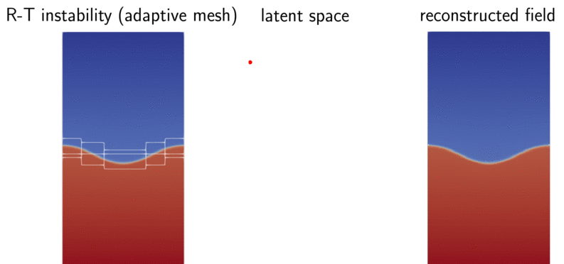

# Neural Implicit Flow (NIF): mesh-agnostic dimensionality reduction

[](https://github.com/pswpswpsw/nif/blob/main/LICENSE)[](https://zenodo.org/badge/latestdoi/460537754)

<p align="center">
  
</p>

- NIF is a mesh-agnostic dimensionality reduction paradigm for parametric spatiotemporal fields. Dimensionality reduction is often the first step in reduced-order modeling of large-scale dynamics.
- NIF represents fields at arbitrary spatial coordinates, including data from adaptive mesh refinement, without requiring interpolation onto a uniform grid. Details can be found in our [paper](https://arxiv.org/pdf/2204.03216.pdf).
- NIF is implemented in **PyTorch**. A ParameterNet maps time or physical parameters to the weights of a coordinate-dependent ShapeNet.

## Highlights

<p align="center">
  
</p>

### Installation and requirements

Python 3.10+ and PyTorch 2.6+ are required; CUDA is optional. Install from a local checkout:

```bash
python -m pip install -e .
# Optional: support TensorBoard logging in the standalone training example.
python -m pip install -e '.[tensorboard]'
```

Choose a suitable PyTorch CUDA wheel for your machine when training on GPU. See [native API and migration notes](docs/PYTORCH_API.md) for optimizer conventions and data formats. The [validation report](docs/PYTORCH_VALIDATION.md) and [comparison records](docs/PYTORCH_TENSORFLOW_PARITY.md) document the measured results and limitations.

### Configuring and training NIF

The example below fits a one-dimensional traveling wave. The configuration dictionaries set the input/output dimensions, network widths, hidden layers, and activations. Input columns are ordered as `[parameters, coordinates]`.

```python
import torch
from nif import NIF
from nif.demo import TravelingWave
from nif.optimizers import AdaBeliefOptimizer

shape = dict(input_dim=1, output_dim=1, units=20, nlayers=2, activation="tanh")
parameter = dict(input_dim=1, latent_dim=2, units=10, nlayers=2, activation="tanh")
model = NIF(shape, parameter).to("cuda" if torch.cuda.is_available() else "cpu")
device = next(model.parameters()).device

data = torch.as_tensor(TravelingWave().data, dtype=torch.float32, device=device)
x, target = data[:, :2], data[:, 2:3]
optimizer = AdaBeliefOptimizer(model.parameters(), lr=1e-3)
for epoch in range(100):
    optimizer.zero_grad(set_to_none=True)
    loss = (model(x) - target).square().mean() + model.regularization_loss(x)
    loss.backward()
    optimizer.step()
print(float(loss.detach()))
```

The default model uses float32. On supported hardware, `mixed_policy="mixed_bfloat16"` or `mixed_policy="mixed_float16"` enables autocast while retaining float32 trainable parameters. See the API notes for details.

### Distributed learning

Use [DistributedDataParallel](https://docs.pytorch.org/docs/stable/generated/torch.nn.parallel.DistributedDataParallel.html) (DDP) to train one model across multiple GPUs, with one process per GPU. The following example shows the data sharding and synchronized training loop. Save it as `train_wave_ddp.py` in the repository root; it reuses `TrainingObjective` from the [training example](examples/train_pytorch.py) to evaluate MSE and regularization together inside the DDP forward pass.

```python
import os
from pathlib import Path

import torch
import torch.distributed as dist
from torch.nn.parallel import DistributedDataParallel as DDP
from torch.utils.data import DataLoader, DistributedSampler, TensorDataset
from nif import NIF
from nif.demo import TravelingWave
from examples.train_pytorch import TrainingObjective

def main():
    local_rank = int(os.environ["LOCAL_RANK"])
    use_cuda = torch.cuda.is_available()
    device = torch.device("cuda", local_rank) if use_cuda else torch.device("cpu")
    if use_cuda:
        torch.cuda.set_device(local_rank)
    dist.init_process_group(backend="nccl" if use_cuda else "gloo")
    try:
        torch.manual_seed(42)
        shape = dict(input_dim=1, output_dim=1, units=20, nlayers=2, activation="tanh")
        parameter = dict(input_dim=1, latent_dim=2, units=10, nlayers=2, activation="tanh")
        model = NIF(shape, parameter).to(device)
        objective = DDP(TrainingObjective(model), device_ids=[local_rank] if use_cuda else None)

        data = torch.as_tensor(TravelingWave().data, dtype=torch.float32)
        dataset = TensorDataset(data[:, :2], data[:, 2:3])
        if len(dataset) % dist.get_world_size():
            raise ValueError("Dataset size must be divisible by the number of processes")
        sampler = DistributedSampler(dataset, shuffle=True, seed=42)
        loader = DataLoader(dataset, batch_size=256, sampler=sampler)
        optimizer = torch.optim.Adam(model.parameters(), lr=1e-3)

        model.train()
        for epoch in range(20):
            sampler.set_epoch(epoch)  # Give every epoch a new shared shuffle.
            for features, targets in loader:
                features, targets = features.to(device), targets.to(device)
                optimizer.zero_grad(set_to_none=True)
                mse, loss = objective(features, targets)
                loss.backward()  # DDP averages gradients across processes.
                optimizer.step()

        if dist.get_rank() == 0:  # Write one copy of the underlying NIF weights.
            output = Path("pytorch_outputs/wave-ddp")
            output.mkdir(parents=True, exist_ok=True)
            torch.save(model.state_dict(), output / "model.pt")
            model.save_config(output / "config.json")
    finally:
        dist.destroy_process_group()

if __name__ == "__main__":
    main()
```

On Linux or WSL, launch this snippet with two CUDA GPUs and an NCCL-enabled PyTorch build, or with CPU/Gloo when CUDA is unavailable:

```bash
torchrun --standalone --nproc-per-node=2 train_wave_ddp.py
```

The complete example also includes a learning-rate schedule, globally reduced metrics, checkpoints, and TensorBoard logging:

```bash
torchrun --standalone --nproc-per-node=2 examples/train_pytorch.py --device cuda --epochs 20 --batch-size 256 --output-dir pytorch_outputs/wave-ddp --tensorboard
```

The batch size is per process: two processes with 256 rows each give a global batch of 512. Equal dataset shards also keep the final batch sizes equal, without padding or dropping samples. The complete example also runs on one device with ordinary `python`; it trains on the same traveling-wave data used above. The L-BFGS example below uses one device. See the [training example validation and requirements](docs/PYTORCH_TRAINING_EXAMPLE.md) for tested platforms and limits.

### Fine-tuning with L-BFGS

After first-order training, refine the same model using a fixed dataset and a closure. This example continues from the model, `x`, and `target` above.

```python
from nif.optimizers import ReferenceLBFGS

fine_tuner = ReferenceLBFGS(model.parameters(), max_iter=1000)
def closure():
    fine_tuner.zero_grad(set_to_none=True)
    loss = (model(x) - target).square().mean() + model.regularization_loss(x)
    loss.backward()
    return loss

fine_tuner.step(closure)
print("Final loss:", float(fine_tuner.result.objective_value))
print("Iterations:", int(fine_tuner.result.num_iterations))
```

### Training schedules and monitoring

Add a [StepLR schedule](https://docs.pytorch.org/docs/stable/generated/torch.optim.lr_scheduler.StepLR.html), TensorBoard scalars, and checkpoints to an explicit PyTorch training loop. This single-device example uses the `model`, `x`, and `target` from the first example and starts a new Adam optimizer. Install the optional TensorBoard dependency shown above.

```python
from pathlib import Path
from torch.utils.tensorboard import SummaryWriter

run = Path("pytorch_outputs/wave-monitored")
run.mkdir(parents=True, exist_ok=True)
model.save_config(run / "config.json")
optimizer = torch.optim.Adam(model.parameters(), lr=1e-3)
scheduler = torch.optim.lr_scheduler.StepLR(optimizer, step_size=10, gamma=0.1)

model.train()
with SummaryWriter(log_dir=str(run / "tensorboard")) as writer:
    for epoch in range(20):
        learning_rate = optimizer.param_groups[0]["lr"]
        optimizer.zero_grad(set_to_none=True)
        mse = (model(x) - target).square().mean()
        loss = mse + model.regularization_loss(x)
        loss.backward()
        optimizer.step()

        writer.add_scalar("train/mse", mse.item(), epoch + 1)
        writer.add_scalar("train/objective", loss.item(), epoch + 1)
        writer.add_scalar("train/lr", learning_rate, epoch + 1)
        print(f"epoch={epoch + 1} mse={mse.item():.6g} lr={learning_rate:.3g}")
        scheduler.step()  # Decay the learning rate after the epoch's updates.
        torch.save({
            "epoch": epoch + 1,
            "model_state_dict": model.state_dict(),
            "optimizer_state_dict": optimizer.state_dict(),
            "scheduler_state_dict": scheduler.state_dict(),
        }, run / "checkpoint.pt")

    model.eval()
    with torch.no_grad():
        final_mse = (model(x) - target).square().mean().item()
    writer.add_scalar("eval/mse", final_mse, epoch + 1)
```

Open these logs with `tensorboard --logdir pytorch_outputs/wave-monitored`. The training scalars above describe each full-batch update; `eval/mse` measures the final weights. Both use the normalized data. The context manager flushes and closes the writer.

For minibatch training with the same schedule and monitoring, run the [complete example](examples/train_pytorch.py) on one CPU:

```bash
python examples/train_pytorch.py --device cpu --epochs 20 --batch-size 256 --output-dir pytorch_outputs/wave --tensorboard
tensorboard --logdir pytorch_outputs/wave
```

For distributed runs, the complete example averages metrics across processes and writes logs and checkpoints on rank zero.

### Extracting subnetworks

Extract the parameter-to-latent, latent-to-weight, and coordinate-to-output subnetworks. These views share the model's tensors and retain their gradient connections.

```python
parameter_inputs, coordinates = x[:, :1], x[:, 1:2]
latent = model.model_p_to_lr()(parameter_inputs)
weights = model.model_lr_to_w()(latent)
u_pred = model.model_x_to_u_given_w()(coordinates, weights)
torch.testing.assert_close(u_pred, model(x))
```

### Input-output Jacobians and Hessians

```python
from nif.layers import JacobianLayer, HessianLayer

output, jacobian = JacobianLayer(model, y_index=[0], x_index=[1])(x)
output, jacobian, hessian = HessianLayer(model, y_index=[0], x_index=[1])(x)
```

The layers return the complete output and selected derivatives, and retain parameter gradients for derivative-based training. See [Tutorial 4](tutorial/4_get_gradients_by_wrapping_model_with_layer_pytorch.ipynb).

### Data normalization

`PointWiseData` keeps parameter, coordinate, and target columns in order and supports min-max or standard normalization. For example, with one parameter, one coordinate, and one output:

```python
from nif.data import PointWiseData

raw_data = TravelingWave().data_raw
normalized, mean, scale = PointWiseData.minmax_normalize(
    raw_data=raw_data, n_para=1, n_x=1, n_target=1
)
```

### Large-scale record data

`TFRDataset` converts an NPZ array into record shards and reads them as PyTorch `DataLoader` batches. This small, self-contained IO example uses the `model`, `optimizer`, and `device` defined above:

```python
from pathlib import Path
from tempfile import TemporaryDirectory
import numpy as np
from nif.data.tfr_dataset import TFRDataset

with TemporaryDirectory() as directory:
    root = Path(directory)
    np.savez(root / "wave.npz", data=TravelingWave().data)
    records = TFRDataset(n_feature=2, n_target=1)
    records.create_from_npz(
        num_pts_per_file=1000, npz_path=root / "wave.npz", npz_key="data",
        tfr_path=root / "record_shards", prefix="wave"
    )
    for shard in records.get_tfr_meta_dataset(root / "record_shards", epoch=1):
        for features, targets in records.gen_dataset_from_batch_file(shard, batch_size=128):
            features, targets = features.to(device), targets.to(device)
            optimizer.zero_grad(set_to_none=True)
            loss = (model(features) - targets).square().mean()
            loss = loss + model.regularization_loss(features)
            loss.backward()
            optimizer.step()
```

[Tutorial 5](tutorial/5_large_scale_training_on_tensorflow_record_data_pytorch.ipynb) demonstrates the same workflow on a one-million-row dataset.

### Save and load models

```python
torch.save(model.state_dict(), "model.pt")
restored = NIF(shape, parameter).to(device)
restored.load_state_dict(torch.load("model.pt", map_location=device, weights_only=True))
torch.testing.assert_close(restored(x), model(x))
model.save_config("config.json")
```

### Network pruning and quantization

Prune a copy of the trained float32 `NIF` from the first example, then run dynamic int8 inference on CPU. The pruning controller below acts on the final ParameterNet projection kernel, leaving its bias unchanged. This short example uses 20 full-batch updates to demonstrate the schedule; choose the pruning budget and target sparsity for your data.

```python
import copy
from torch import nn
from nif.pruning import PolynomialMagnitudePruning

compressed = copy.deepcopy(model).cpu().float().train()
features, targets = x.detach().cpu().float(), target.detach().cpu().float()
projection = compressed.pnet_list[-1].linear
pruner = PolynomialMagnitudePruning(
    projection, name="weight", initial_sparsity=0.1, final_sparsity=0.9,
    begin_step=0, end_step=20, frequency=1,
)
pruning_optimizer = torch.optim.Adam(compressed.parameters(), lr=1e-4)
for epoch in range(20):
    pruning_optimizer.zero_grad(set_to_none=True)
    loss = (compressed(features) - targets).square().mean()
    loss = loss + compressed.regularization_loss(features)
    loss.backward()
    pruning_optimizer.step()
    pruner.on_epoch_end()  # Reapply the mask before checkpointing or inference.

pruner.strip()  # Keep sparse weights; remove pruning hooks before conversion.
compressed.eval()
print("Projection sparsity:", (projection.weight == 0).float().mean().item())
int8_model = torch.ao.quantization.quantize_dynamic(
    compressed, {nn.Linear}, dtype=torch.qint8, inplace=False
).eval()
with torch.no_grad():
    float_prediction = compressed(features)
    int8_prediction = int8_model(features)
    print("Pruned-model MAE:", (float_prediction - targets).abs().mean().item())
    print("Int8-model MAE:", (int8_prediction - targets).abs().mean().item())
    print("Quantization MAE:", (int8_prediction - float_prediction).abs().mean().item())
```

[Dynamic quantization](https://docs.pytorch.org/docs/stable/generated/torch.ao.quantization.quantize_dynamic.html) converts this model's native `nn.Linear` layers in ParameterNet to packed int8 CPU kernels. Custom residual layers and the generated ShapeNet computation remain floating point. All three MAEs use normalized output units; compare them before choosing the compressed model.

[Tutorial 7](tutorial/7_model_pruning_and_quantization_pytorch.ipynb) shows the full multiscale pruning experiment and TorchScript export. Its SIREN projection uses `HyperLinearForSIREN.w`, which the tutorial converts to `nn.Linear` with the original weight orientation preserved before quantization.

## Google Colab Tutorial

The notebooks below run the native PyTorch examples. Their scientific workloads are the default; set `NIF_SMOKE=1` before running only for a short development check.

1. **Hello world! A simple fitting on a 1D traveling wave** [](https://colab.research.google.com/github/pswpswpsw/nif/blob/main/tutorial/1_simple_1d_wave_pytorch.ipynb)
    - Learn the `nif.NIF` model, its configuration, and training loop.
    - Save and restore checkpoints; refine the fit with L-BFGS.

2. **Tackling multi-scale data** [](https://colab.research.google.com/github/pswpswpsw/nif/blob/main/tutorial/2_multi_scale_NIF_pytorch.ipynb)
    - Use `nif.NIFMultiScale` and compare fits to a high-frequency wave.

3. **Learning a linear representation** [](https://colab.research.google.com/github/pswpswpsw/nif/blob/main/tutorial/3_multi_scale_linear_NIF_pytorch.ipynb)
    - Use `nif.NIFMultiScaleLastLayerParameterized` on a cylinder-flow dataset from an adaptive mesh.

4. **Getting input-output derivatives** [](https://colab.research.google.com/github/pswpswpsw/nif/blob/main/tutorial/4_get_gradients_by_wrapping_model_with_layer_pytorch.ipynb)
    - Use `nif.layers.JacobianLayer` and `nif.layers.HessianLayer`.

5. **Large-scale data training** [](https://colab.research.google.com/github/pswpswpsw/nif/blob/main/tutorial/5_large_scale_training_on_tensorflow_record_data_pytorch.ipynb)
    - Create and stream record shards using `nif.data.tfr_dataset.TFRDataset`.
    - Train on batches from a one-million-row example dataset.

6. **Revisit multi-scale data with regularization** [](https://colab.research.google.com/github/pswpswpsw/nif/blob/main/tutorial/6_revisit_multi_scale_NIF_with_L1_L2_regularization_pytorch.ipynb)
    - Compare L1 and L2 regularization of ParameterNet weights and biases.
    - Inspect training fits and spurious signals on a refined space-time grid.

7. **NIF compression** [](https://colab.research.google.com/github/pswpswpsw/nif/blob/main/tutorial/7_model_pruning_and_quantization_pytorch.ipynb)
    - Explore magnitude pruning, dynamic int8 quantization, and exported inference.

8. **Revisit multi-scale data with Sobolev training** [](https://colab.research.google.com/github/pswpswpsw/nif/blob/main/tutorial/8_revisit_multi_scale_NIF_with_sobolov_training_pytorch.ipynb)
    - Add spatial-derivative supervision with `nif.layers.JacobianLayer` and compare field and derivative errors.
    - Inspect how derivative information affects the refined spatial prediction.

## Issues, bugs, requests, ideas

Use the [issues](https://github.com/pswpswpsw/nif/issues) tracker to report bugs.

## How to cite

For the software, use [GitHub's citation metadata](CITATION.cff) and the [Zenodo software record](https://doi.org/10.5281/zenodo.7909312). The latter DOI represents all archived software versions. Cite the version-specific DOI from the Zenodo record when referring to a particular release.

If you find NIF is helpful, please cite our JMLR [paper](https://www.jmlr.org/papers/volume24/22-0365/22-0365.pdf):

```bibtex
@article{JMLR:v24:22-0365,
  author  = {Shaowu Pan and Steven L. Brunton and J. Nathan Kutz},
  title   = {Neural Implicit Flow: a mesh-agnostic dimensionality reduction paradigm of spatio-temporal data},
  journal = {Journal of Machine Learning Research},
  year    = {2023},
  volume  = {24},
  number  = {41},
  pages   = {1--60},
  url     = {http://jmlr.org/papers/v24/22-0365.html}
}
```

## Contributors

- [Shaowu Pan](http://www.shaowupan.com)
- [Yaser Afshar](https://github.com/yafshar)

## License

[LGPL-2.1 License](https://github.com/pswpswpsw/nif/blob/main/LICENSE)
