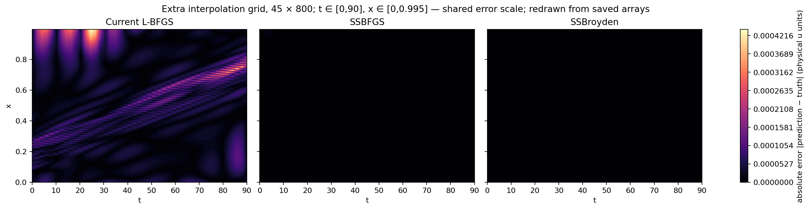
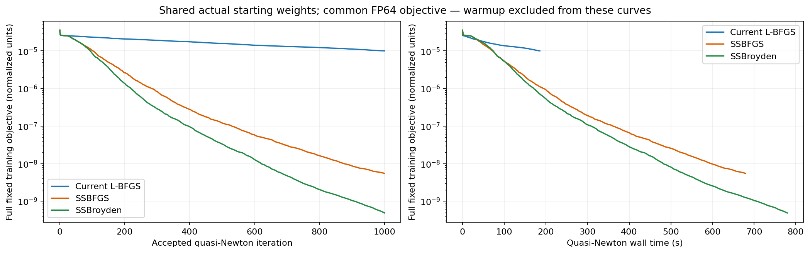

# Experimental self-scaled optimizers

[Open Tutorial 9 in Colab](https://colab.research.google.com/github/pswpswpsw/nif/blob/main/tutorial/9_self_scaled_optimizers_pytorch.ipynb) or read the [notebook source](../tutorial/9_self_scaled_optimizers_pytorch.ipynb). This post-v2.0.0 example compares `ReferenceLBFGS`, the author's `SSBFGS_AB` and `SSBroyden2` on T1's traveling wave. It trains a fresh model and reports its own errors, timings and raw optimizer states. The eight released tutorials and supported `nif.optimizers` API retain their existing scope.

The algorithms accompany Kiyani et al., [*Optimizing the Optimizer for Physics-Informed Neural Networks and Kolmogorov-Arnold Networks*](https://arxiv.org/abs/2501.16371). The NIF experiments below evaluate field fitting.

## Run the comparison

Use Python 3.11–3.13 with the [portable environment setup](../examples/self_scaled/README.md), or run the Colab notebook from its first cell. Colab creates a separate pinned environment for the numerical subprocess. From a checkout, choose a fresh output directory:

```bash
python examples/self_scaled/benchmark.py --output pytorch_outputs/self_scaled-full
python examples/self_scaled/benchmark.py --help
```

The default FULL workload can take half an hour or more on a laptop-class CPU. `--smoke` on the CLI, or `NIF_SMOKE=1` before notebook execution, selects a labeled two-epoch/three-iteration development check. Existing results are preserved.

## Numerical controls

The case is `u(t,x)=exp(-1000*z**2)*sin(4*z)`, with `z=x-0.2-0.006*t`.

| Control | Definition |
|---|---|
| Data and model | Original 2,000 T1 rows in `[t,x]` order, original normalization statistics, and the original 30-unit/two-hidden-layer Swish NIF. Stored FP32 arrays are uniformly cast to FP64; casting retains their original rounding. |
| Shared warmup | One 5,000-epoch AdaBelief fit, batch size 512, original learning-rate schedule and recorded batch sequence. Each arm reloads the same actual tensors; initial parameters, objective and full-gradient fingerprints are compared. |
| Quasi-Newton budget | One round capped at 1,000 iterations per arm in FP64. Original T1 instead used FP32 and 200 L-BFGS rounds. |
| Fixed objective | Full-data normalized field MSE plus `model.regularization_loss(features)`, using its true gradient throughout line searches. Warmup and QN use no gradient centralization. |
| Backends | L-BFGS: Hager–Zhang, 20 correction pairs. Author self-scaled methods: dense inverse-Hessian updates, Strong Wolfe (`c1=1e-4,c2=.9,initial_scale=False`). |
| Hardware and memory | Sequential CPU execution, two numerical threads. One 5,853×5,853 FP64 inverse Hessian occupies 261.4 MiB, plus temporary matrices. |
| Errors | Physical RMSE, MAE and maximum absolute error. The original 10×200 grid compares with stored physical targets; the additional 45×800 grid compares with the analytical field over `t∈[0,90],x∈[0,.995]`. |
| Timing and status | QN time includes line search, objective/gradient evaluations, curvature updates and logging; warmup, prediction and plotting are separate. Raw termination and finite-state checks distinguish convergence, iteration limits, precision loss and invalid states. |

Different line searches and stopping contracts make these comparisons measurements of the complete implementations. The figures label original-style normalized contours separately from physical-field and absolute-error views. Coordinate pairing is checked point by point before reshaping.

## Source and dependency provenance

The [author source](https://github.com/EliKiani/Optimizing_the_Optimizer_PINNs/blob/990a82c1353cbda9f5afee3200b222fdb821c521/_optimize.py) is fixed to commit `990a82c1353cbda9f5afee3200b222fdb821c521`. The adapter downloads the original 160,175 bytes into a versioned cache, verifies them before loading, retains their notice and leaves installed SciPy files intact. The external module is obtained at runtime; the NIF repository contains the adapter. The [upstream license file](https://github.com/EliKiani/Optimizing_the_Optimizer_PINNs/blob/990a82c1353cbda9f5afee3200b222fdb821c521/LICENSE) at that commit contains a single newline.

```text
Author source SHA256:
65958e6bba33631ca5aeab9ecc309536199c08a7e380fc0487d404e93ae2687e
```

The backend uses SciPy private interfaces. [Requirements](../examples/self_scaled/requirements.txt) pin `scipy==1.16.3`, `numpy==2.1.3` and the remaining environment. Historical runs used a whitespace-normalized copy of the same numerical source, SHA256 `cc2380115343c2622581d8479ed1be27f56545277e130ed89cd651a4488d901b`.

## Recorded T1 comparison

The following measurements and figures are the **historical 2026-10-27 run**, copied from saved metrics and prediction-array plots. They are separate from the new notebook's fresh execution. The run used one common 5,000-epoch warmup (150.343 seconds), one 1,000-iteration quasi-Newton round per method, FP64 and sequential two-thread Windows CPU execution. All three methods exhausted that round's iteration budget and did not meet their strict convergence criteria.

Physical absolute errors below use the additional 45×800 interpolation grid, with `t` in `[0, 90]` and `x` in `[0, 0.995]`, against the FP64 analytical field. This grid includes new model evaluations at intermediate times and locations; it is distinct from the original 10×200 training grid.

| Method | RMSE | MAE | Maximum absolute error | QN seconds |
|---|---:|---:|---:|---:|
| L-BFGS | 6.06450e-5 | 3.87712e-5 | 4.39122e-4 | 185.481 |
| SSBFGS | 1.25679e-6 | 8.14594e-7 | 1.24311e-5 | 679.350 |
| SSBroyden | 3.76647e-7 | 2.46498e-7 | 3.09220e-6 | 779.385 |

In this run, the self-scaled methods obtained smaller final errors and took longer. Comparing the last accepted states within the common observed time window of 185.481 seconds also gave lower training objectives for the self-scaled methods. Those training-objective values are distinct from dense-grid physical errors, and the L-BFGS curve is not extrapolated beyond its measured duration.

The original-style normalized contour views are preserved for [L-BFGS](source/_static/self_scaled/lbfgs_original_style.png), [SSBFGS](source/_static/self_scaled/ssbfgs_original_style.png) and [SSBroyden](source/_static/self_scaled/ssbroyden_original_style.png): `contourf`, time horizontal, position vertical, time-major `reshape(10, 200)`, 50 levels, `seismic`, and the original color limits.

The first figure below compares the historical predictions on the original training grid in physical units. The displayed physical-field and absolute-error comparisons are separately labeled additional views of saved arrays.


The next figure uses actual model predictions on the additional interpolation grid, rather than display interpolation of the training image.



Convergence is shown against accepted iterations and measured quasi-Newton wall time. The common warmup is excluded from the horizontal time axis.



The [machine-readable historical results](source/_static/self_scaled/historical_results.json) retain full-precision metrics, raw termination information, source-record hashes and the hashes of these unchanged PNG files. The stored training targets and the analytical interpolation targets are identified separately.

## What the other recorded cases show

These are separate extensions of the accepted tutorials. T2, T3, T5 and T6 originally had no quasi-Newton stage; their added stages are experiments rather than reproductions of an original L-BFGS workload. Values in each row are ordered **L-BFGS / SSBFGS / SSBroyden**.

- **T2, high-frequency wave:** SIREN training RMSE fell from `3.73409e-4` to `1.05576e-4 / 1.05103e-4`, while spatially refined RMSE at the ten training times changed from `0.0618492` to `0.0626397 / 0.0626330`. The denser field did not improve. All three SIREN runs used their 1,000-iteration budget. Swish did not resolve the high-frequency wave; the self-scaled Swish runs ended with `status=2` (precision loss). Separate matched-weight TF/PT checks supported agreement of the measured forward implementation; they did not explain every cause of the between-point fitting error.
- **T3, cylinder flow:** the area-weighted normalized objective was `0.00166727 / 0.00136311 / 0.00135909`, with QN times `1495.9 / 849.7 / 864.8` seconds. The self-scaled results improved the physical `v` component and worsened `u`. The lower total objective therefore does not mean every component improved. All three runs used 1,000 iterations.
- **T5, streamed random-label data:** all methods reached MSE about `0.0832870`, with QN times `5.919 / 3.058 / 3.634` seconds. This one-million-row example uses independent random inputs and labels, so its error does not measure physical-field generalization. The L-BFGS method stopped on objective change; both self-scaled methods returned `status=2` (precision loss). Timing followed a common full-data cache warmup.
- **T6, nine regularization conditions:** lower training error did not give a consistent benefit on the original 371×371 evaluation grid. For the unregularized example, training RMSE was `2.78955e-4 / 6.91539e-5 / 6.80009e-5`, while original-grid RMSE was `0.182235 / 0.182904 / 0.182906`; QN times were `227.4 / 658.8 / 765.7` seconds. That baseline's L-BFGS and self-scaled timings came from separate processes after an interruption, with the same starting checkpoint. A large L2 coefficient produced early termination but a nearly constant field; optimizer success alone does not establish useful fitting quality.

## Execution evidence

Both fresh FULL runs used 5,000 shared AdaBelief epochs (20,000 updates) and 1,000 QN iterations per method. Independent checkpoint restoration reproduced their common starting objectives/gradients and physical errors. Each full run returned finite states with `iteration_limit` for all three arms.

| Record | Workload and outputs | Environment |
|---|---|---|
| [Linux FULL](source/_static/self_scaled/tutorial9_validation.json) | Seven code cells, real GitHub checkout and isolated installation, eight figures; these scientific outputs are retained in the notebook. | Python 3.13.11, PyTorch 2.14.1+cpu, CPU FP64. |
| [Colab FULL](source/_static/self_scaled/tutorial9_colab_validation.json) | Seven original code cells and eight figures; independent saved-result recomputation. Shared warmup: 369.081 seconds. | Python 3.13.16, PyTorch 2.14.1+cu130 executing on CPU FP64. |
| [Colab bridge SMOKE](source/_static/self_scaled/tutorial9_colab_smoke_validation.json) | All seven then-current code cells after the progress-display update, two warmup epochs, three QN iterations per arm and eight figures. CI also executes this shortened workload. | Separate execution check, with exact source hashes and captured progress. |

The Colab FULL additional-grid errors were:

| Method | RMSE | MAE | Maximum absolute error | QN seconds |
|---|---:|---:|---:|---:|
| L-BFGS | 5.92239e-5 | 3.96800e-5 | 4.18842e-4 | 268.381 |
| SSBFGS | 1.20181e-6 | 8.57544e-7 | 6.78848e-6 | 869.558 |
| SSBroyden | 3.46040e-7 | 2.29437e-7 | 2.62609e-6 | 950.578 |

The receipts retain their original commits, versions, numerical results and image hashes. The progress-display update changed subprocess output transport; the later [presentation manifest](source/_static/self_scaled/tutorial9_presentation.json) connects the streamlined notebook to those recorded runs through unchanged code and PNG hashes. These presentation changes required no new full training.

## Scope

These are single-start CPU measurements. Multi-seed estimates, GPU/DDP acceleration and stochastic mini-batch QN are outside the tested scope; the line-search objective remains fixed full-batch. T4, T7 and T8 have no self-scaled comparison in this collection.

The frozen author SSBroyden backend can produce nonfinite states with degenerate curvature. The runner retains failures and checks final parameters, gradients and dense inverse-Hessian state. Historical T1 retained finite final parameters and recomputed predictions, but its final dense Hessian was not saved for retrospective inspection.

The eight released tutorials have separate [scientific comparison and user-review records](PYTORCH_TENSORFLOW_PARITY.md).
