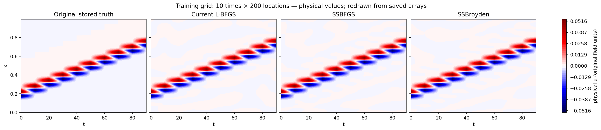

# Experimental self-scaled optimizers

[Open Tutorial 9 in Colab](https://colab.research.google.com/github/pswpswpsw/nif/blob/main/tutorial/9_self_scaled_optimizers_pytorch.ipynb) or read the [notebook source](../tutorial/9_self_scaled_optimizers_pytorch.ipynb). This post-v2.0.0 experiment compares NIF's `ReferenceLBFGS` with the author's `SSBFGS_AB` and `SSBroyden2` implementations on Tutorial 1's traveling wave. The new notebook trains a fresh model and computes its own results. It preserves the eight released tutorials and the `nif.optimizers` API.

The methods come from Kiyani et al., [*Optimizing the Optimizer for Physics-Informed Neural Networks and Kolmogorov-Arnold Networks*](https://arxiv.org/abs/2501.16371). These NIF experiments measure their behavior on field fitting; they do not reproduce the paper's PINN or KAN experiments.

## Run the comparison

Use a Colab CPU runtime with Python 3.11–3.13, or follow the [portable example setup](../examples/self_scaled/README.md) in a checkout. The notebook downloads its support code, creates a separate pinned Python environment and runs the numerical work in a subprocess. It does not replace packages already loaded in the Colab kernel. Run its cells from the beginning in a fresh session.

After installing the example's pinned environment, run a full comparison from
the checkout root. Choose a new output directory for each run to preserve
previous evidence:

```bash
python examples/self_scaled/benchmark.py --output pytorch_outputs/self_scaled-full
python examples/self_scaled/benchmark.py --help
```

The default full comparison uses 5,000 AdaBelief warmup epochs followed by one round of at most 1,000 accepted quasi-Newton iterations for each method. The original T1 tutorial instead allows 200 L-BFGS rounds; this experiment gives all three methods the same smaller round budget. The historical two-thread CPU run took about half an hour including its common warmup. Colab timings depend on the allocated CPU. `NIF_SMOKE=1` selects a short development execution check; its plots and error table describe that shortened run and do not reproduce the full-budget results below.

All three quasi-Newton backends run on CPU. The two self-scaled implementations use dense NumPy/SciPy inverse-Hessian matrices, whereas L-BFGS keeps 20 correction pairs. With 5,853 model parameters, one dense float64 matrix occupies about **261.4 MiB**; intermediate matrices require additional memory. A GPU runtime does not move the SciPy algorithm onto the GPU. These examples have no measured multi-GPU, DDP or stochastic mini-batch SS acceleration.

## Numerical controls

Tutorial 9 uses the original 2,000 training rows, original normalization statistics, original Swish network configuration and original traveling-wave definition:

```text
u(t, x) = exp(-1000 * (x - 0.2 - 0.006*t)^2) * sin(4 * (x - 0.2 - 0.006*t))
```

The original stored data and normalization arrays are converted to float64; conversion does not recover precision lost in the source arrays. One AdaBelief warmup produces the shared starting checkpoint. Each quasi-Newton method then loads those same actual model tensors. The run records the starting parameter, first objective and first-gradient fingerprints rather than relying on a common random seed alone.

The fixed full-batch objective is:

```python
loss = (model(features) - normalized_target).square().mean()
loss = loss + model.regularization_loss(features)
```

The quasi-Newton phase uses the true gradient of this objective, without gradient centralization, a log-loss transform, resampling or architecture changes. The original AdaBelief learning-rate schedule and batch size 512 are retained for the warmup.

The baseline uses `ReferenceLBFGS`, Hager–Zhang line search and 20 correction pairs. The self-scaled backends use the author's full-matrix updates and Strong Wolfe line search. Their line searches, memory representations and stopping contracts differ. The comparison therefore measures the complete implementations under a common initialization, objective, precision and iteration ceiling. Timings include objective/gradient evaluations, line search and curvature updates; common warmup, prediction and plotting times are reported separately. Raw termination states and nonfinite-state checks are retained. Reaching the iteration budget is not labeled convergence.

## Source and dependency provenance

The [author's repository](https://github.com/EliKiani/Optimizing_the_Optimizer_PINNs) is fixed to commit `990a82c1353cbda9f5afee3200b222fdb821c521`. The experiment downloads its original `_optimize.py` bytes at runtime into a separate cache, verifies the SHA256 before loading and leaves installed SciPy files intact. NIF publishes its adapter and teaching code; it does not vendor this external file or relabel it as NIF source. The upstream notice is retained in the downloaded bytes. See the [pinned source](https://github.com/EliKiani/Optimizing_the_Optimizer_PINNs/blob/990a82c1353cbda9f5afee3200b222fdb821c521/_optimize.py) and [upstream license file](https://github.com/EliKiani/Optimizing_the_Optimizer_PINNs/blob/990a82c1353cbda9f5afee3200b222fdb821c521/LICENSE), whose contents at that commit are a single newline.

```text
Author source SHA256:
65958e6bba33631ca5aeab9ecc309536199c08a7e380fc0487d404e93ae2687e
```

The backend depends on private SciPy interfaces. The example pins `scipy==1.16.3` and `numpy==2.1.3`; the complete environment is in [requirements.txt](../examples/self_scaled/requirements.txt). Compatibility with other SciPy versions is not established. The historical experiments used a whitespace-normalized copy of the same author source, with SHA256 `cc2380115343c2622581d8479ed1be27f56545277e130ed89cd651a4488d901b`; the numerical source was unchanged.

## Recorded T1 comparison

The following measurements and figures are the **historical 2026-10-27 run**, copied from saved metrics and prediction-array plots. They are separate from the new notebook's fresh execution. The run used one common 5,000-epoch warmup (150.343 seconds), one 1,000-iteration quasi-Newton round per method, FP64 and sequential two-thread Windows CPU execution. All three methods exhausted that round's iteration budget and did not meet their strict convergence criteria.

Physical absolute errors below use the additional 45×800 interpolation grid, with `t` in `[0, 90]` and `x` in `[0, 0.995]`, against the FP64 analytical field. This grid includes new model evaluations at intermediate times and locations; it is distinct from the original 10×200 training grid.

| Method | RMSE | MAE | Maximum absolute error | QN seconds |
|---|---:|---:|---:|---:|
| L-BFGS | 6.06450e-5 | 3.87712e-5 | 4.39122e-4 | 185.481 |
| SSBFGS | 1.25679e-6 | 8.14594e-7 | 1.24311e-5 | 679.350 |
| SSBroyden | 3.76647e-7 | 2.46498e-7 | 3.09220e-6 | 779.385 |

In this run, the self-scaled methods obtained smaller final errors and took longer. Comparing the last accepted states within the common observed time window of 185.481 seconds also gave lower training objectives for the self-scaled methods. Those training-objective values are distinct from dense-grid physical errors, and the L-BFGS curve is not extrapolated beyond its measured duration.

The original-style normalized contour views are preserved for [L-BFGS](source/_static/self_scaled/lbfgs_original_style.png), [SSBFGS](source/_static/self_scaled/ssbfgs_original_style.png) and [SSBroyden](source/_static/self_scaled/ssbroyden_original_style.png): `contourf`, time horizontal, position vertical, time-major `reshape(10, 200)`, 50 levels, `seismic`, and the original color limits.

The first figure below compares the historical predictions on the original training grid in physical units. The displayed physical-field and absolute-error comparisons are separately labeled additional views of saved arrays.



The next figure uses actual model predictions on the additional interpolation grid, rather than display interpolation of the training image.


Convergence is shown against accepted iterations and measured quasi-Newton wall time. The common warmup is excluded from the horizontal time axis.


The [machine-readable historical results](source/_static/self_scaled/historical_results.json) retain full-precision metrics, raw termination information, source-record hashes and the hashes of these unchanged PNG files. The stored training targets and the analytical interpolation targets are identified separately.

## What the other recorded cases show

These are separate extensions of the accepted tutorials. T2, T3, T5 and T6 originally had no quasi-Newton stage; their added stages are experiments rather than reproductions of an original L-BFGS workload. Values in each row are ordered **L-BFGS / SSBFGS / SSBroyden**.

- **T2, high-frequency wave:** SIREN training RMSE fell from `3.73409e-4` to `1.05576e-4 / 1.05103e-4`, while spatially refined RMSE at the ten training times changed from `0.0618492` to `0.0626397 / 0.0626330`. The denser field did not improve. All three SIREN runs used their 1,000-iteration budget. Swish did not resolve the high-frequency wave; the self-scaled Swish runs ended with `status=2` (precision loss). Separate matched-weight TF/PT checks supported agreement of the measured forward implementation; they did not explain every cause of the between-point fitting error.
- **T3, cylinder flow:** the area-weighted normalized objective was `0.00166727 / 0.00136311 / 0.00135909`, with QN times `1495.9 / 849.7 / 864.8` seconds. The self-scaled results improved the physical `v` component and worsened `u`. The lower total objective therefore does not mean every component improved. All three runs used 1,000 iterations.
- **T5, streamed random-label data:** all methods reached MSE about `0.0832870`, with QN times `5.919 / 3.058 / 3.634` seconds. This one-million-row example uses independent random inputs and labels, so its error does not measure physical-field generalization. The L-BFGS method stopped on objective change; both self-scaled methods returned `status=2` (precision loss). Timing followed a common full-data cache warmup.
- **T6, nine regularization conditions:** lower training error did not give a consistent benefit on the original 371×371 evaluation grid. For the unregularized example, training RMSE was `2.78955e-4 / 6.91539e-5 / 6.80009e-5`, while original-grid RMSE was `0.182235 / 0.182904 / 0.182906`; QN times were `227.4 / 658.8 / 765.7` seconds. That baseline's L-BFGS and self-scaled timings came from separate processes after an interruption, with the same starting checkpoint. A large L2 coefficient produced early termination but a nearly constant field; optimizer success alone does not establish useful fitting quality.

## Validation scope and remaining work

Tutorial 9 completed all seven code cells in a fresh Linux Python 3.13 kernel on
2026-11-15, including the real GitHub checkout and isolated dependency installation.
The default FULL workload performed 5,000 shared AdaBelief epochs (20,000 updates)
and 1,000 quasi-Newton iterations per method, producing eight figures. Independent
checkpoint restoration reproduced the common initial objective and gradient and
the physical errors on both grids. All three methods reached their iteration
ceiling with finite states; none is relabeled as converged.

The notebook retains those actual scientific outputs and labels their source;
installation and progress logs are omitted. **Run all** computes a new comparison.
The [full execution receipt](source/_static/self_scaled/tutorial9_validation.json)
contains the immutable source commits, environment versions, numerical results and
image hashes. CI also executes every code cell in the explicitly shortened SMOKE
mode, including environment creation and all three optimization paths.

The recorded results are single-start CPU comparisons, not multi-seed estimates or universal speed rankings. T4, T7 and T8 have no self-scaled comparison in this collection. The fixed full-batch objective is deliberate: random changes of batch between line-search evaluations have not been validated here.

The frozen author SSBroyden backend can produce nonfinite states in degenerate-curvature conditions. The new runner reports such failures and checks finite parameters, gradients and final dense inverse-Hessian state; it does not present these experiments as hardened production optimizers. The historical normal T1 run had finite final parameters and recomputed predictions, but its final dense Hessian was not retained for retrospective inspection.

The eight released tutorials have their own [scientific comparison and user-acceptance records](PYTORCH_TENSORFLOW_PARITY.md). Acceptance of those tutorials and validation of this new experimental teaching workflow are separate scopes.
