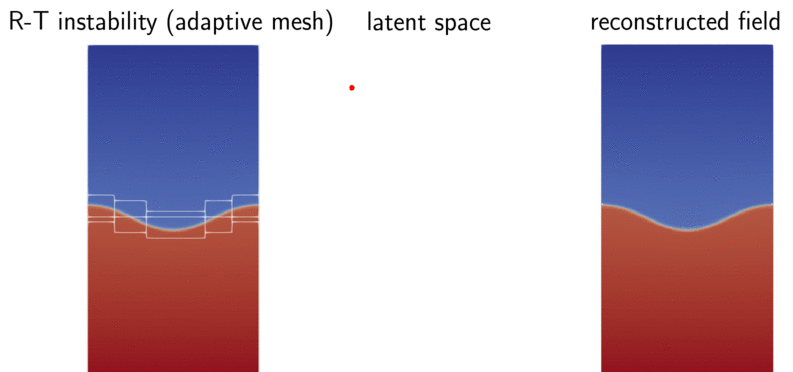
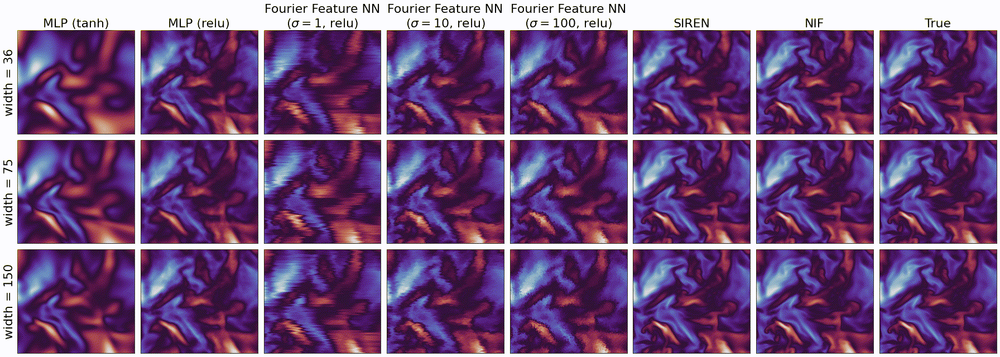

Neural Implicit Flow — PyTorch v2.0.0
============================================================

NIF provides mesh-agnostic dimensionality reduction for parametric
spatiotemporal fields. A ParameterNet maps time or physical parameters to
the weights of a coordinate-dependent ShapeNet, which evaluates the field
at spatial query points.

The native PyTorch package includes multiscale neural fields, linear spatial
bases, differentiable Jacobians and Hessians, regularization, streamed data,
and optimization tools. The examples cover training, checkpoints, distributed
learning, monitoring, pruning, and quantized inference.

Start with :doc:`quickstart`, then explore the eight scientific cases in
:doc:`tutorials`. Python 3.10+ and PyTorch 2.6+ are required; CUDA is optional.
The API pages below are generated from the actual implementation imported
during the documentation build.

Getting started
---------------

.. toctree::
   :maxdepth: 2

   quickstart
   tutorials
   training_example

API reference
-------------

.. toctree::
   :maxdepth: 2

   api_nif_model
   api_nif_layers
   api_nif_optimizers
   api_nif_data
   api_nif_demo
   api_nif_pruning

Scientific definitions and validation
------------------------------------------------------------

.. toctree::
   :maxdepth: 1

   api_guide
   validation
   comparison_records

Release and historical references
---------------------------------

* `GitHub v2.0.0 release <https://github.com/pswpswpsw/nif/releases/tag/v2.0.0>`_
* `Software DOI: 10.5281/zenodo.23752197 <https://doi.org/10.5281/zenodo.23752197>`_
* `JMLR paper <https://www.jmlr.org/papers/v24/22-0365.html>`_
* `Original TensorFlow documentation archive <legacy/tensorflow/index.html>`_

The historical documentation is preserved with its original examples and assets.
Use the PyTorch guides and API reference above for version 2.0.0.

* :ref:`genindex`
* :ref:`search`
